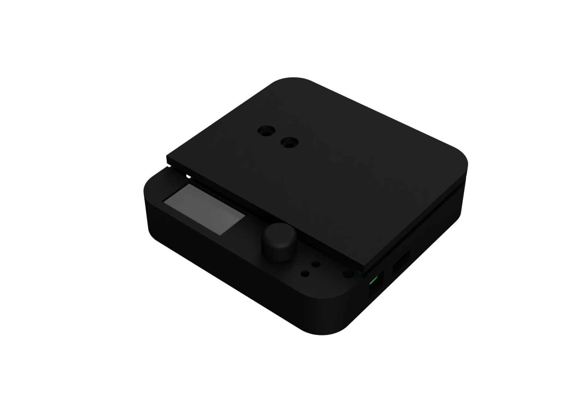

# Coffee-Scale

---

This project contains the schematics, code and 3D models for a coffee scale based on an ESP32.

**[Read the manual](https://coffee-scale.orlopau.dev)**, in English and German: setting up, weighing, espresso, recipes, settings and calibration, with the scale's real screens.

## Features
* Espresso timer with a target weight, the shot's curve when it ends, and the shot before for comparison
* Shot detection (off by default): notices a shot by itself, times it from the pump start and stops at the pump stop
* Step-by-step recipes for pour-over and Aeropress, with adjustable coffee and ratio
* Lift-to-tare: slide a finger up the side of the platform, lifting it a little, and the scale tares with a double beep. Also with a cup on it, and never while the timer runs. Off, Gentle, Normal or Firm in the settings.
* Auto-tare for containers whose weight you saved, and zero tracking that keeps the empty scale at zero
* Auto averaging of weight values: more values are used to determine weight when weight is relatively constant
* Calibration on the scale, with a 100 g weight
* Wi-Fi setup from the phone: scan the QR code on the display, no app
* Automatic updates over Wi-Fi, which ask before installing and roll back if a firmware doesn't start
* English and German firmware
* USB-C charging
* Interchangeable load cell
* 3D-printable case

## Development
How to install builds from your computer, record the load cell, run the emulator and the screenshot tests: [code/docs/development.md](code/docs/development.md). What comes next: [code/docs/roadmap.md](code/docs/roadmap.md). The manual's source is in [docs/](docs/), built with Hugo.
