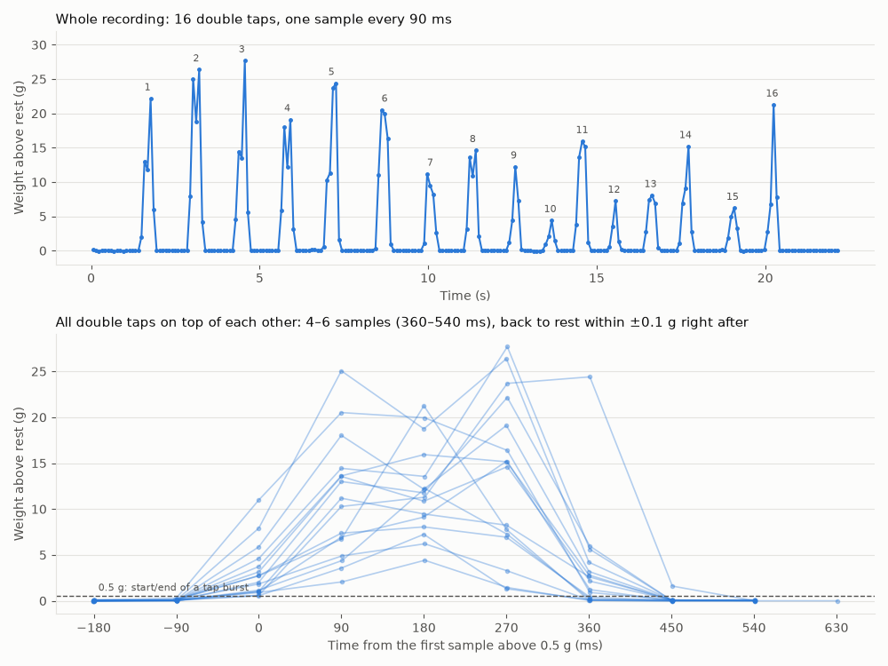
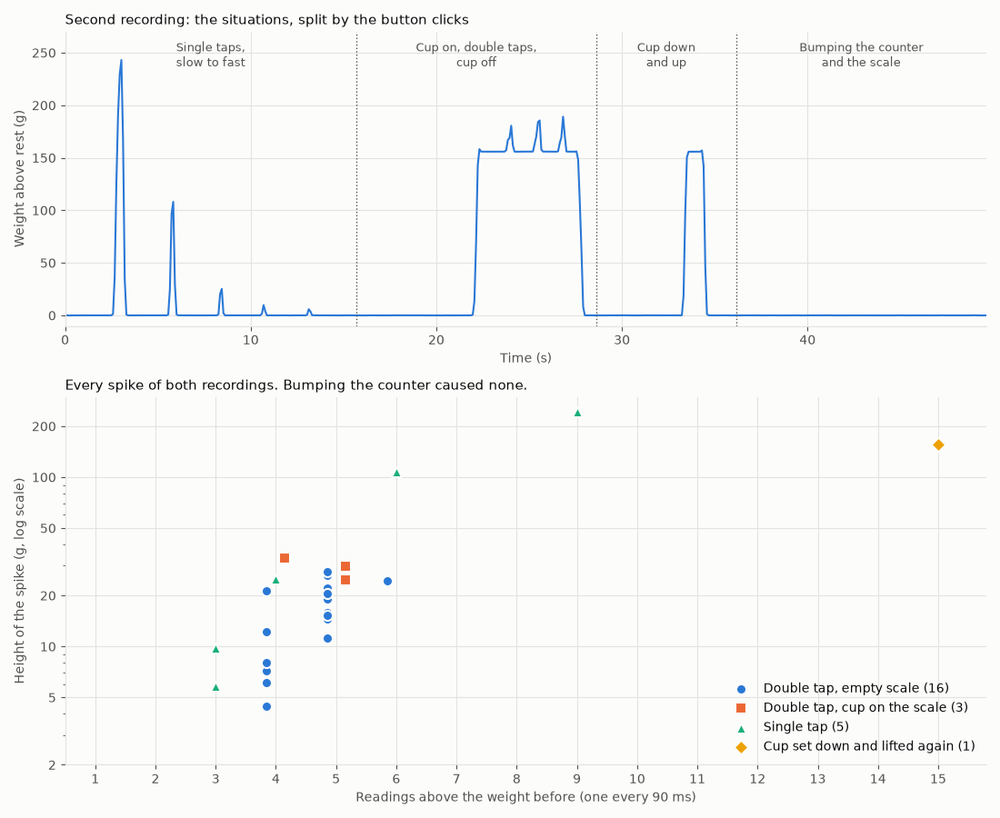
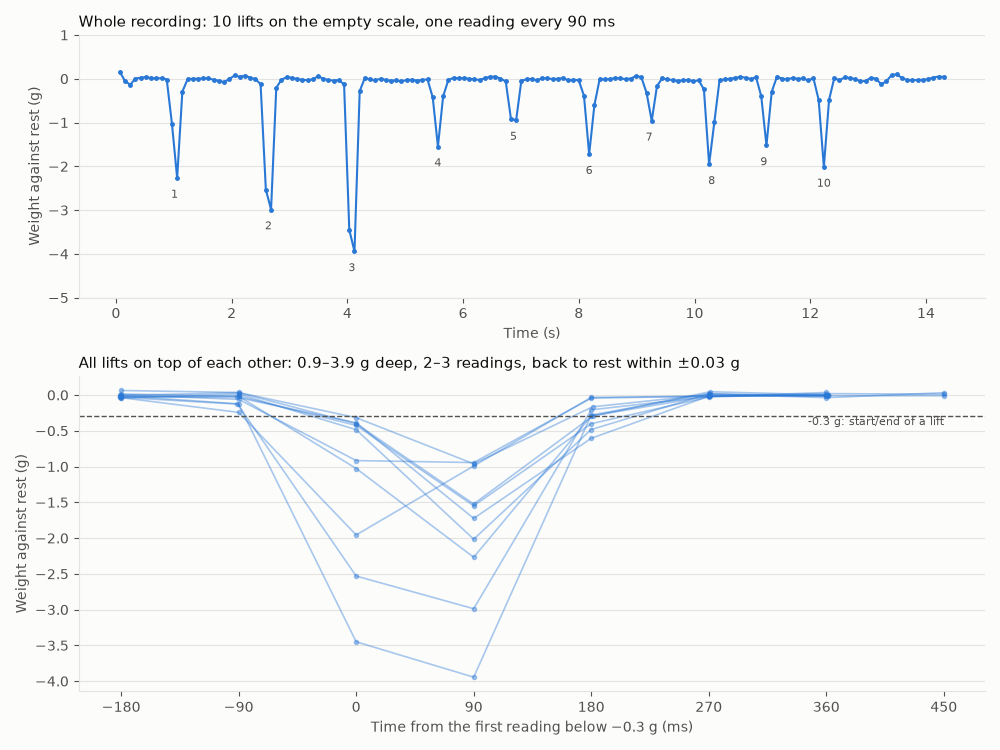
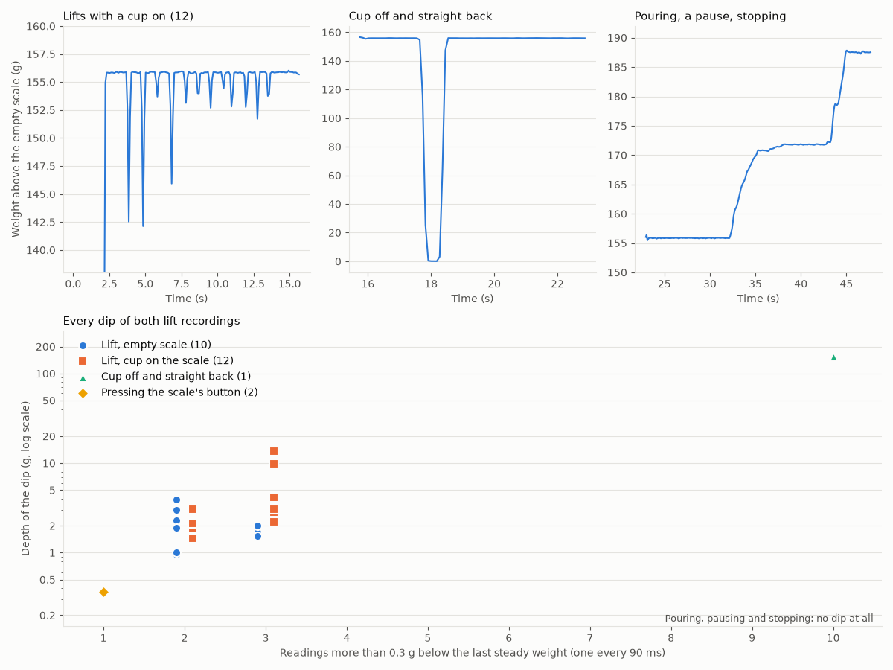

# 1. Lift the platform to tare, not tap it

Status: accepted, 2026-10-11

## Context

The roadmap planned tap-to-tare: tapping the platform twice tares. Another item said to check first, with real recordings, whether 10 readings per second are enough to see a tap. The HX711 delivers one reading every 90 ms, so a tap is only one or two readings long.

So before designing the detector, we recorded the gestures and everyday situations on the scale (`pio run -t record`), looked at each recording, and let the data choose the gesture. The recordings are in `code/test/recordings/`, where the replay tests read them, and the diagrams next to this ADR in `0001-tare-gesture/`.

## How we got there

### 1. Double taps on the empty scale

The first recording has 16 double taps on the empty scale.

- At rest, the readings scatter by σ ≈ 0.04 g.
- Each double tap is one spike, 4–6 readings above 0.5 g (360–540 ms), 4.4–28 g high. Even the weakest is about 100× the noise.
- Right after the spike, the weight is back at rest, at most 0.12 g away.
- The two taps of a double tap mostly merge into one spike. Only 5 of the 16 show a dip between the taps, and that dip never reaches rest. At 90 ms per reading, we can't count two taps.

So a "double tap" is really a short spike that returns to the weight before. Next we needed to know whether a single tap or an everyday situation looks the same.

### 2. Single taps, a cup, bumps

The second recording covers, separated by button clicks: single taps from slow to fast, double taps with a cup (156 g) on the scale, the cup set down and lifted off again, and bumping the counter and the scale.

- Bumping the counter or the scale shows nothing. The largest deviation was 0.16 g.
- Double taps with the cup look like those on the empty scale: 4–5 readings, 25–33 g above the cup, and afterwards back at the cup's weight. (We meant to make two, the recording shows three.)
- Setting the cup down and lifting it off again lasts 15 readings at 156 g. Its length tells it apart.
- Single taps can't be told apart from double taps. The slow ones are presses, long and high (9 readings at 243 g, 6 at 108 g). But the third one (4 readings, 25 g) lies right among the double taps, and the fast ones (3 readings, 6–10 g) are only one reading shorter than the shortest double tap.

At this point we had three options:

1. **Any short tap tares.** A spike of 3–6 readings, at most about 60 g, back at the weight before. Easy to detect, but a single tap tares too, and the roadmap's "twice" is gone.
2. **Two separate taps,** each back at rest, within about a second. Reliable, but the natural double taps of the first recording merge, so people would have to learn to tap slowly.
3. **Read the HX711 at 80 Hz.** Needs its RATE pin, possibly a hardware change, and raises the noise by about 2.8×.

### 3. Lifting instead of tapping

Instead, we tried a different gesture: sliding a finger up the side of the platform, lifting it a little. Everything we had recorded so far pushes the weight up: taps, presses, cups, pouring. A short dip below the weight before, that comes right back, would be a signal nothing else gives. The only everyday thing that lowers the weight is taking something off, and then the weight stays down.

The third recording has 10 lifts on the empty scale.

- Each lift is 2–3 readings more than 0.3 g below rest (180–270 ms), 0.95–3.9 g deep. Shallower than a tap, but even the shallowest is about 20× the noise.
- Afterwards the weight is back at rest within ±0.05 g.
- None of the earlier recordings ever went below rest: the lowest reading was −0.14 g, also after the taps on the cup.

### 4. Lifts with a cup, the cup off and back, pouring

What was left were the situations that lower the weight. The fourth recording covers, separated by button clicks: lifts with the cup on the scale, the cup taken off and put straight back, and pouring with a pause and a clear stop.

- The 12 lifts with the cup look like those on the empty scale: 2–3 readings, 1.5–14 g below the cup's weight (deeper, because the cup is lifted too), back at the cup's weight within ±0.11 g.
- The cup taken off and put straight back, as fast as it naturally goes, lasts 10 readings and drops the full 156 g. Its length tells it apart.
- Pouring, its pause and its stop show no dip. When the pour stops, the weight settles by about 0.3 g, slowly.
- A surprise: pressing the scale's own button for the marks pushes the scale down by 0.7 g. On release it springs back 0.37 g below rest, for one reading. A lift has to go deeper than that.

Across all four recordings, nothing else looks like a lift.

## Decision

Lifting the platform tares, instead of tapping it.

The detector looks for a dip below the last steady weight, measured from the recordings:

- **Steady weight:** three readings within 0.3 g of each other.
- **Dip:** at least **0.7 g** below the steady weight. The button's spring-back reached 0.37 g, the shallowest lift 0.95 g.
- **Length:** **1–5 readings** below it. Lifts took 2–3, the cup off and back 10.
- **Back:** afterwards within **±0.3 g** of the steady weight. Lifts came back within ±0.11 g.

The detector itself (where it sits, how it is locked during a shot, what the display shows) is designed separately.

## Consequences

- The gesture is unusual: people have to learn it, unlike a tap. In return, nothing on the counter tares the scale by accident.
- It works with a cup on the scale, so a dripper or cup can be tared without taking it off.
- Single and double taps stay free for other uses.
- A cup lifted off and put back within about half a second looks like a lift and tares. In the recording it took 0.9 s even done fast, so this should be rare, and the worst case is 0.00 on the display with the cup on.
- The thresholds rest on two lift recordings by one person on one scale. The four recordings become replay tests for the detector: every lift must tare, nothing else may.
- How firmly you have to lift is a setting: the dip's depth, 0.7 g by default. People who lift gently, or scales that sit differently, can lower it, down to above the button's spring-back at 0.37 g.
- The roadmap's "Tap-to-tare" becomes "Lift-to-tare".
