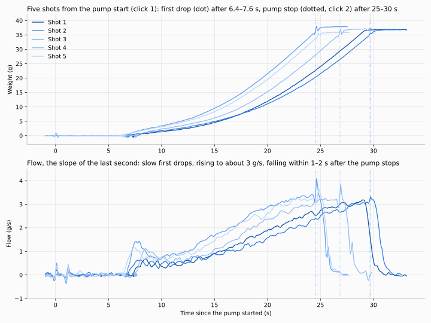
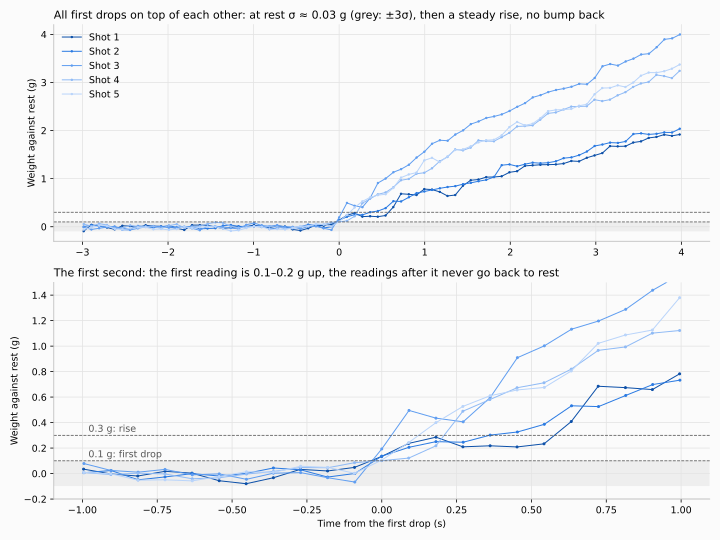
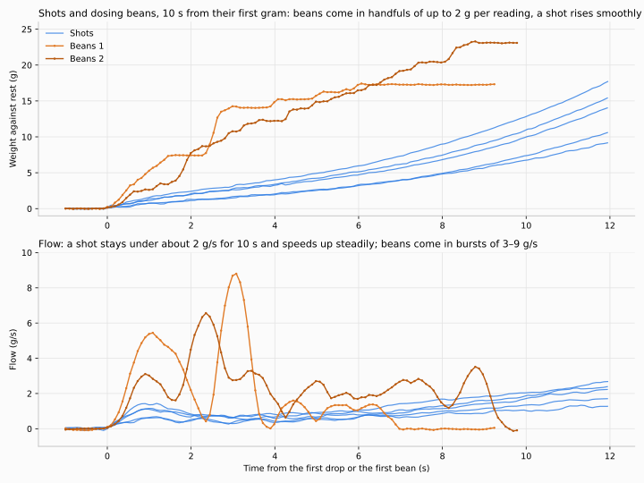
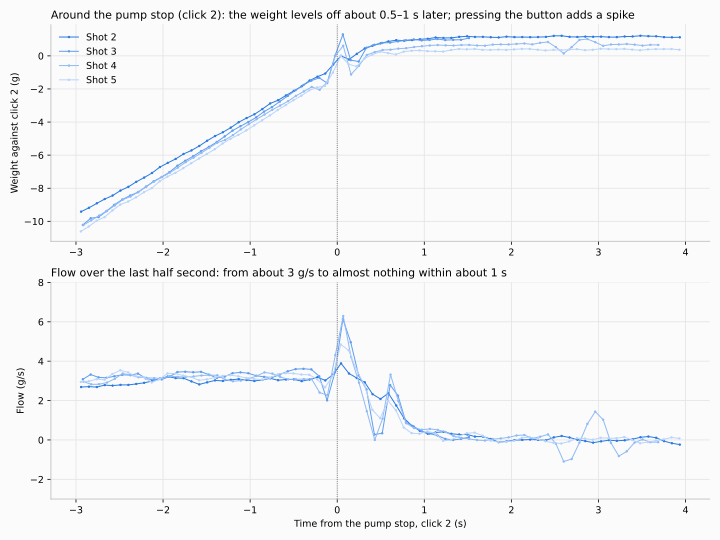
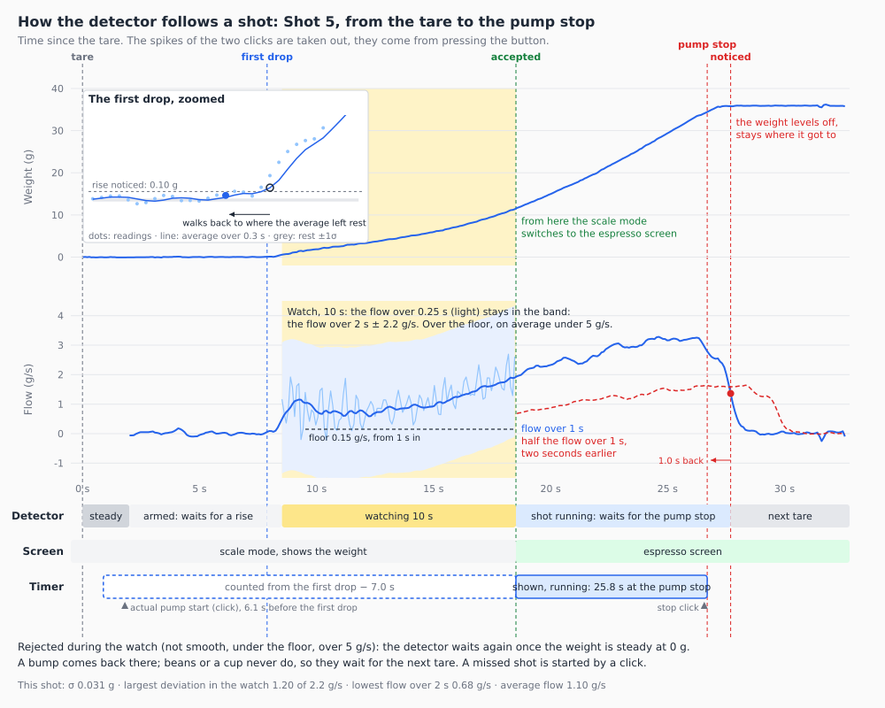

# 2. Detect a shot from the first drop to the pump stop

Status: accepted, 2026-10-26

## Context

Today an espresso takes four steps by hand: long-press, turn to Espresso, click (it tares and starts the timer), and the timer stops at the target weight. The scale should notice a shot by itself: switch from the scale mode to the espresso screen and start the timer.

The timer should count from the pump start. The scale can't see the pump, but it can see the first drop, which comes a while later. So the timer would start backdated to the first drop, minus an offset for the time before it. Ideally the scale also stops the timer by itself when the pump stops, so the shot time is the time the pump ran.

Before designing the detector, we recorded real shots and what happens at the machine around them, as in ADR 1, and let the data decide. The recordings are in `recordings/`, and the diagrams are next to this ADR.

## The recordings

Seven recordings of shots and beans, one person, one scale, one machine, and one of a second, noisier scale at rest:

| Recording | What | Clicks |
| --- | --- | --- |
| [`17-23-18_2`](recordings/2026-10-26_17-23-18_2.csv) | Shot 1 | pump start only (the stop click was forgotten) |
| [`17-23-19_2`](recordings/2026-10-26_17-23-19_2.csv) | Shot 2 | pump start, pump stop |
| [`17-23-19_3`](recordings/2026-10-26_17-23-19_3.csv) | Shot 3 | pump start, pump stop, then the cup is lifted |
| [`17-23-19_4`](recordings/2026-10-26_17-23-19_4.csv) | Shot 4 | tare, pump start, pump stop |
| [`17-23-19_5`](recordings/2026-10-26_17-23-19_5.csv) | Shot 5, into a 142 g cup | tare, pump start, pump stop |
| [`17-23-18`](recordings/2026-10-26_17-23-18.csv) | Beans 1: a cup set down, tared, about 17 g of beans added | tare |
| [`17-23-19`](recordings/2026-10-26_17-23-19.csv) | Beans 2: 23 g of beans into a tared container, lifted, some taken out, put back at 17 g | none |
| [`17-56-40`](recordings/2026-10-26_17-56-40.csv) | A second scale with a 5 kg load cell, 22 s at rest | none |

The clicks mark the pump start and the pump stop. The first drop needs no click: it's easy to see in the weight. The recorder tares at its first reading, so the shots without a tare click start tared too.

Every click leaves a short spike in the weight, because pressing the scale's button pushes the scale down (ADR 1 saw the same). The spikes in the diagrams at the pump start and the pump stop come from the clicks, not from the machine. They won't be there in normal use.

Not recorded: grinding into a cup, which isn't done on the scale, and a pour-over, which may not count as a shot.

## How we got there

### 1. Five shots

- From pump start to first drop: **6.4–7.6 s**, on average 7.0 s.
- From pump start to pump stop: 24.6–29.7 s. From the first drop to the pump stop: 18–23 s.
- 36–37.4 g in the cup.
- The flow starts at 0.3–1.5 g/s and speeds up steadily to about 3 g/s at the end. The short peaks at 0 s and around the pump stop are the clicks. Some shots begin with a short pulse of about 1.4 g/s and then slow down again for a few seconds.

### 2. The first drops

- At rest the readings scatter by σ ≈ 0.03 g, like in ADR 1.
- The first drop is clear: the first reading is 0.1–0.2 g above rest, more than 3σ.
- After that the weight never comes back to rest. It goes above 0.3 g within 0.1–0.6 s and above 1 g within 0.5–1.8 s.
- Before the first drop, the only bumps are from pressing the button for the click. The scale was already in place under the portafilter, so sliding it in isn't recorded.

### 3. Shots and dosing beans

Dosing beans happens in the scale mode, into a tared cup, at the machine, before every shot. It must not switch to the espresso screen.

Over the first 10 s after the first drop or the first bean:

| | Shots (5) | Beans (2) |
| --- | --- | --- |
| Highest flow over 0.25 s | 1.5–2.2 g/s | 11.8–18.1 g/s |
| Highest flow over 0.5 s | 1.2–2.1 g/s | 8.1–11.6 g/s |
| Highest flow over 1 s | 1.1–2.0 g/s | 5.3–6.3 g/s |
| Flow over 0.25 s against the flow over 2 s around it: typical / largest deviation | 0.23–0.29 / 0.68–0.77 g/s | 2.2–3.4 / 7.9–14.9 g/s |
| Weight after 10 s | 6.7–12.7 g | 17–23 g |
| Pauses | none longer than 0.3 s | between handfuls, and flat once dosed |

- Beans arrive in handfuls. The weight goes up in steps of up to 2 g per reading, with pauses in between.
- A shot rises smoothly, never more than about 0.3 g per reading, and its flow only speeds up slowly.
- The average flow alone doesn't separate them. Beans 2 adds 23 g in 10 s, about 2.3 g/s, more than a shot's own average of 1.6–2 g/s from the first drop.
- The highest flow separates them, and a short window separates them best. A shot flows evenly and looks about the same over 0.25 s as over a second. Beans flow in bursts: over a second a handful averages out with the pause after it, over 0.25 s it shows its full speed. Over 0.2–0.3 s they are 5× apart, over 1 s only 2.6×. Shorter than 0.2 s, the noise of the readings begins to count.
- The window is a time, measured on the readings' timestamps, not a number of readings, so it holds at other reading rates. At 90 ms per reading it holds 3 readings; a much slower rate would leave it too few.
- A shot's flow isn't constant, it speeds up from about 0.5 to 3 g/s, but it is smooth: over 0.25 s it deviates from the flow over the 2 s around it by about 0.25 g/s, as little as the noise of the readings alone. Beans deviate about 10× more. A human pouring water probably can't be that smooth either, but no pour-over was recorded.
- Within the first 2 s only one or two handfuls have fallen. Watching longer gives the beans more chances to show a burst or a pause.

### 4. The pump stop

- Until the pump stops, the flow is steady at about 3 g/s.
- After the click, the weight levels off within **0.5–1 s**. The flow falls from about 3 g/s to below 0.5 g/s within about 1 s, and stays there.
- After the pump stop, another 0.4–1.2 g still reaches the cup.
- The spike right at the click, up to about 6 g/s in the flow, is the button press, not the pump. It hides the first few tenths of a second after the pump stop. Its rebound pulls the flow over 0.5 s below 0.5 g/s for a moment 0.4 s after the click in Shots 3 and 4, before the flow has really fallen.
- Against the shot's own flow the stop is clearer. The flow over 1 s, against the flow over 1 s two seconds earlier, stays above 0.91× during the shots (0.87× with the 5 kg scale's noise added: near the end the flow levels off at about 3 g/s). After the pump stop it falls to 0.03–0.04×, and crosses half 0.88–1.04 s after the stop click, with no early crossing from the button.

So the pump stop is visible: a fast, high flow collapses to almost nothing within a second. The weight sees it about 0.5–1 s late. A click lags what it marks by a few hundred milliseconds too, so the true lag is probably a bit shorter. A recording with the pump stop marked without touching the scale would show the drop without the spike.

### 5. A noisier scale

The scale of the shots has a 1 kg load cell. Scales with a 5 kg load cell spread the same amplifier over 5× the range, so they are noisier. The last recording is such a scale at rest.

| At rest | 1 kg (Shot 2, before the first drop) | 5 kg |
| --- | --- | --- |
| Scatter around the 2 s line, σ | 0.03 g | 0.06–0.12 g |
| Flow over 2 s | −0.00 to +0.04 g/s | −0.10 to +0.08 g/s |
| Flow over 1 s | −0.07 to +0.10 g/s | −0.37 to +0.30 g/s |
| Flow over 0.5 s | −0.13 to +0.19 g/s | −0.59 to +0.68 g/s |
| Flow over 0.25 s against the flow over 2 s around it, largest deviation | 0.40 g/s | 1.41 g/s |

- The 5 kg scale is 2–4× noisier.
- Over 2 s its flow at rest stays within ±0.1 g/s. Over 1 s and shorter, the noise alone reaches the flows of a shot's first seconds (0.3–0.5 g/s).
- No shot was recorded on it. How a shot looks there follows from the shots above plus this noise: adding its recorded noise to the shots and the beans, at many offsets, the shots deviate by up to 2.0 g/s (from 0.8), the beans still by 6.6–12.7 g/s.
- The deviation of the flow over 0.25 s at rest spreads by 0.23 g/s (1 kg) and 0.69 g/s (5 kg). That is the noise of a line through 3 readings 90 ms apart, σ / √Σ(t−t̄)² = σ / 0.127 s: 0.22 and 0.71 g/s.

## Decision

- **Only after a tare.** The cup is always tared before a shot, so the detector only watches once the weight has been steady at about 0 g after a tare. Drips after the shot, or a cup set down, start no shot. After a shot it waits for the next tare. After a rejected rise it waits again once the weight is steady at about 0 g, as after a tare: a bump or noise comes back there, beans or a cup don't, so they wait for the next tare.
- **Where it acts.** In the scale mode a detected shot switches to the espresso screen and starts the timer; on the espresso screen it starts the timer, unless a shot is running. Recipes, calibration, the settings and the mode switcher are never interrupted.
- **One setting turns shot detection on or off,** in the scale mode and on the espresso screen alike. It is off by default for now, until it has proven itself on more scales and machines than the one it was recorded on. Off, the espresso screen works as before: a click starts the shot, and the timer stops at the target weight or at a second click; the pump stop does nothing.
- **The detector takes its time.** It watches the rise for 10 s, about half a shot, before it decides. The watch starts when the flow reaches the floor (below), 0.3–0.6 s after the first drop in these shots. Detecting reliably matters more than detecting fast: the timer is backdated to the first drop anyway.
- **Smoothness tells a shot from everything else.** Over the whole watch, the flow over 0.25 s stays close to the flow over the 2 s around it: within about 2.2 g/s on this scale (shots up to 0.8, beans 7.9–14.9), more on a noisier one, see the values. The flow may change slowly, as a shot speeds up; it may not wobble. No pause rule on top.
- **Bumps.** A bump before the first drop, e.g. sliding the scale under the portafilter, comes back to about 0 g: if its spike started a watch, the watch is rejected and the detector waits again once the weight is steady at 0 g. A bump during the watch breaks the smoothness and the rise is rejected; with coffee in the cup the weight doesn't come back to 0 g, so the detector waits for the next tare. A shot missed that way is started by a click.
- **A fixed floor and ceiling, no setting.** Over the watch, the flow over 2 s never drops below about 0.15 g/s, half the slowest shot (0.32 g/s); over 2 s even the 5 kg scale's noise stays within ±0.1 g/s. So a few drops that stop or a drifting scale are no shot. A slow start isn't lost: the flow over 2 s still holds the rest before the first drop, so the watch begins once it reaches the floor; the timer still counts from the first drop. At that moment the flow is right at the floor, and a dip of noise would reject the shot, so the floor only applies from 1 s into the watch; by then the shots flow at 0.4 g/s or more. On average over the watch the flow stays below about 5 g/s: these shots averaged 0.7–1.3 g/s, a turbo shot of 36 g in 15 s about 2.5 g/s, a pour-over pours an estimated 5–10 g/s (not recorded). The ceiling only backs up smoothness against a very steady pour. Turbo shots and lungos need no setting.
- **With shot detection on, the shot ends at the pump stop or a click, nothing else.** The pump stop is where the flow collapses from shot flow to almost nothing: the flow over 1 s falls below half the flow over 1 s two seconds earlier. Measured against the shot's own flow, not a fixed g/s value, it holds for a shot flowing 1 g/s just after the watch as for one flowing 3 g/s, and on the noisier scale. The timer stops where the flow began to fall, not where the weight levels off 0.5–1 s later. Only a real pump stop counts: the flow falls to about zero while the weight stays where it got to. Lifting the cup drops the weight far below that and is no pump stop; the shot goes on, and if the pump stops while the cup is off, a click ends the shot. A click stops it as before. Once the detector has accepted the shot, the target weight no longer stops it, but stays on the screen with its progress bar and the time left, so the user knows when to stop the pump.
- **The end doesn't care how the shot started.** With shot detection on, a shot started by a click ends the same way. The pump stop only counts once the detector has accepted the rise as a shot: a shot started by a click runs through the seconds before the first drop, when nothing flows yet, and that is no pump stop. Until the detector accepts it, a shot started by a click ends as with shot detection off: at the target weight or a click. So a shot whose rise was rejected, e.g. after a bump, still ends by itself.
- **The offset is a setting,** default 7.0 s, the mean gap from pump start to first drop in these shots (6.4–7.6 s). The gap depends on the machine, its preinfusion, the grind and the dose.
- **The noise is measured, not assumed.** This scale has a 1 kg load cell and is quiet (σ ≈ 0.03 g). The 5 kg scale is 2–4× noisier. So the detector measures the noise in the steady stretch after the tare, and the values that depend on it are multiples of it: the first drop and the smoothness. On this scale they come out as below. Steady itself is judged by the flow over 2 s, below the floor, not by a spread of the weight, so it needs no noise to be known first. The floor, the ceiling and the pump stop are flows of the coffee and are measured over windows long enough for both scales.
- **Its own readings.** The detector reads each reading in grams before the display's averaging and zero tracking, against its own reference taken at the tare. Zero tracking could swallow the 0.1–0.2 g of the first drops, and the adaptive averaging would change the noise the detector measures.
- **Averaged, because slow is fine.** Every flow is a line through all readings of its window, not the difference of its two ends. A rise is noticed on the weight averaged over 0.3 s, which is quieter (5 kg: σ 0.096 → 0.063 g). Noticing it later costs nothing: the detector decides after the watch anyway, and then walks back to the last moment the averaged weight was at rest; the reading after it is the first drop, the timer counts from there. The timer needs to be accurate to about 1 s, so a first drop a few tenths of a second early, when the weight creeps up just before the shot, is fine. Smoothness is the exception: its 0.25 s window stays short on purpose, averaging would blur the handfuls it is there to see.
- **All windows are times,** measured on the readings' timestamps, never a number of readings, so the detector holds at other reading rates, as long as the 0.25 s window still holds about 3 readings.

### The values

| What | Value | From the recordings |
| --- | --- | --- |
| Watch before deciding | 10 s from when the flow over 2 s reaches the floor | about half a shot (first drop to pump stop: 18–23 s); the floor is reached 0.3–0.6 s after the first drop |
| Smoothness: short window | 0.25 s | beans and shots furthest apart at 0.2–0.3 s; shorter, noise counts |
| Smoothness: window around it | 2 s | |
| Smoothness: largest deviation | 1.5 g/s plus 3× the noise of a flow over 0.25 s, a line through its readings (σ / √Σ(t−t̄)², with 3 readings 90 ms apart σ / 0.127 s): about 2.2 g/s (1 kg), 2.9–4.3 g/s (5 kg) | that noise measures 0.23 g/s (1 kg), 0.69 g/s (5 kg) at rest; shots up to 0.8 (1 kg), up to 2.0 with the 5 kg noise; beans 6.6 and more on both |
| Floor: lowest flow over 2 s | 0.15 g/s, from 1 s into the watch | half the slowest shot (0.32 g/s); noise over 2 s within ±0.1 g/s on both scales; 1 s into the watch the shots flow at 0.4 g/s or more |
| Ceiling: average flow over the watch | 5 g/s | shots 0.7–1.3, turbo about 2.5, pour-over an estimated 5–10 |
| Steady after a tare | 2 s whose flow is within the floor, ±0.15 g/s, their mean within 0.3 g of 0, scattering by σ < 0.5 g | flow over 2 s at rest within ±0.04 (1 kg), ±0.1 g/s (5 kg) |
| Waiting again after a rejection | steady at about 0 g, as after a tare | a bump comes back to rest; beans and a cup don't |
| Noise σ | the scatter of the steady 2 s around their line, of single readings and of the weight averaged over 0.3 s | single: 0.03 g (1 kg), 0.06–0.12 g (5 kg); averaged 5 kg: 0.063 g |
| Rise noticed | the weight averaged over 0.3 s more than 3σ of that average above the steady weight, at least 0.1 g | 5 kg: about 0.19 g instead of 0.29 g on single readings |
| First drop | afterwards: the reading after the last one where the averaged weight was no more than 1σ above the steady weight | the first reading of a shot is 0.11–0.19 g up; a creep of a few hundredths of a gram before it can move the first drop a few tenths of a second earlier (Shot 5: 0.4 s), well within the 1 s the timer needs |
| Pump stop: flow | the flow over 1 s falls below half the flow over 1 s two seconds earlier; a weight that falls is the cup lifted, see below | during the shots it stays above 0.87× of it, also with the 5 kg noise; after the stop it falls to 0.03–0.04×, crossing half 0.88–1.04 s after the stop click |
| Pump stop: time | 1.0 s before the flow fell below half | within about 0.1 s of the stop click; the weight lags the pump by 0.5–1 s, the click lags the pump too |
| Cup lifted | the weight drops more than 5 g below the shot's highest weight; the end waits until it is back within 5 g | lifting takes 130–200 g off; the clicks' spikes stay under 2 g |
| Offset, the setting's default | 7.0 s | pump start to first drop 6.4–7.6 s |

## Consequences

- In the scale mode, the screen switches to the espresso screen about 10.5 s after the first drop, about 17.5 s after the pump start, with the timer already running from the pump start.
- The shot time is the time the pump ran, without a click at either end, as long as the offset fits the machine.
- With shot detection on, the target weight becomes a guide once the shot is accepted: the user stops the pump when it is reached, and the scale notices. Before that, and in a shot whose rise was rejected, it still stops the shot.
- Shot detection can't miss a shot without a way out: a shot it rejected, e.g. after a bump, is started by a click. That click tares, as before, so the coffee already in the cup no longer counts.
- A bump or noise before the first drop doesn't use up the detector: it waits again once the weight is back at 0 g.
- No setting for how fast a shot flows: smoothness, a fixed floor, a fixed ceiling and a pump stop against the shot's own flow hold for turbo shots and lungos alike.
- The thresholds rest on five shots and two bean dosings by one person on one machine. The recordings become replay tests: every shot must be found, its first drop where the weight leaves rest, its pump stop within 0.5 s of the stop click, and nothing else.
- Grinding into a cup isn't done on the scale, so it isn't recorded. A pour-over isn't recorded either: the pause after its bloom should fail the floor, and smoothness and the ceiling are expected to reject the pours, but nothing shows it. If one does switch to the espresso screen, the mode switcher leads back.
- On the 5 kg scale a rise is noticed later, but the first drop is found by walking back, so its timer starts where the weight left rest, a little later than on the quiet scale at most. No shot was recorded on it: the rules for it rest on its noise at rest and the shots of the 1 kg scale.
- The detector keeps its own reference and reads the weight before the display's averaging and zero tracking, so the display's filters can change without touching the detector.
- In the recordings the pump stop lands within about 0.1 s of the stop click. The click itself lags the pump by a few hundred milliseconds, and its spike hides the first moments after it, so the true accuracy is about ±0.5 s.
- Later the scale could learn the offset by itself: in a shot started by a click at the pump start, the gap to the detected first drop is exactly the offset.
- Later the scale could also measure its noise once, while the load cell is calibrated, instead of only in the steady stretch after each tare.
