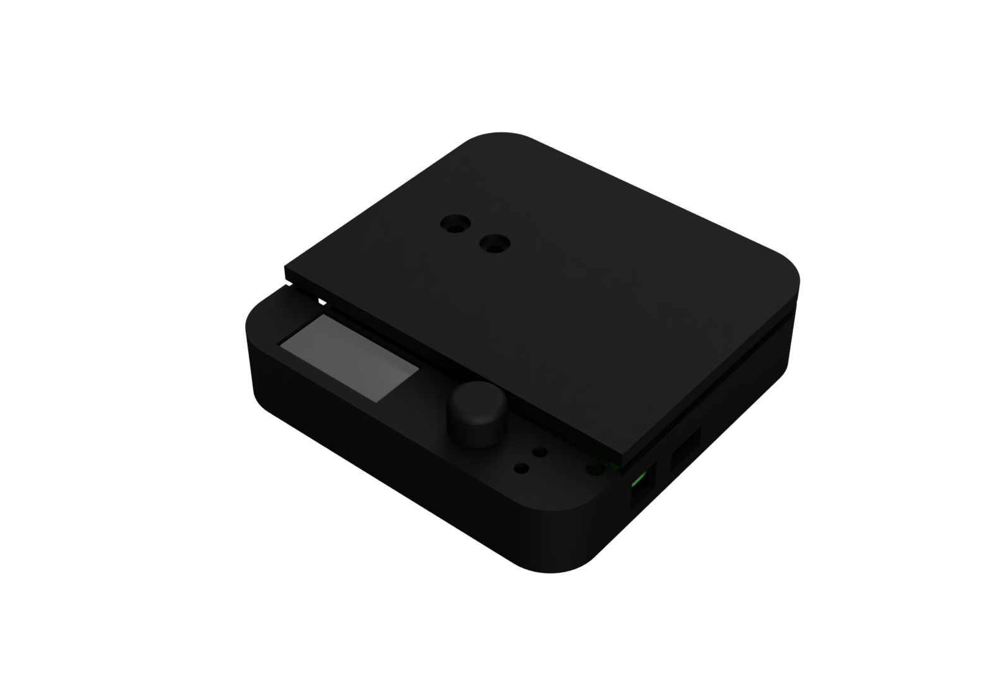


  Eine Kaffeewaage, die weiß,&nbsp; wann dein Shot beginnt



  Wiegt deinen Kaffee, stoppt Espresso-Shots von selbst&nbsp; und führt dich Schritt für Schritt durch Filterkaffee-Rezepte.





  
  
  
  
  
  

