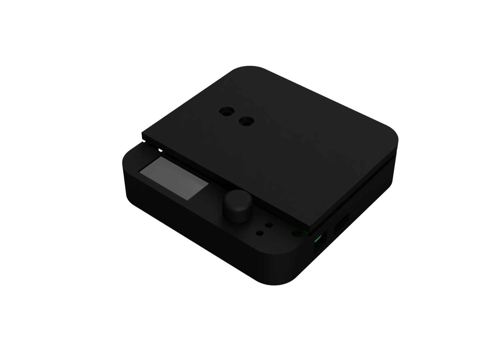


  A coffee scale that&nbsp; knows when your shot starts



  Weighs your coffee, times espresso shots by itself&nbsp; and walks you through pour-over recipes, step by step.





  
  
  
  
  
  
  

